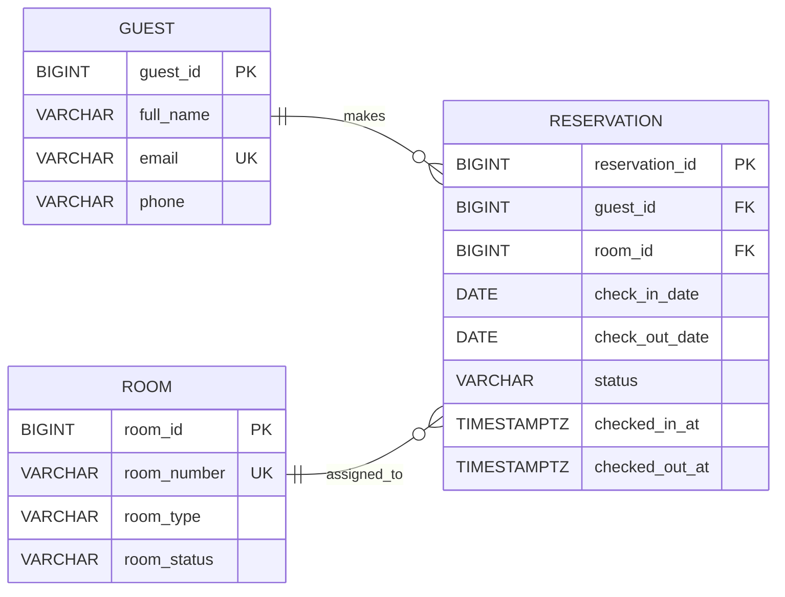

# Hotel Reservation System Database Design ER Diagram

## Entity Relationship Diagram

The diagram represents the three entities in the Hotel Reservation System: Guest, Room and Reservation. It shows their attributes, primary keys, foreign keys, unique fields and relationships.

## Explanation of Diagram Symbols

The diagram uses the following key symbols:

- **PK (Primary Key):** A field that uniquely identifies each record in a table. For example, `guest_id` uniquely identifies every guest.
- **FK (Foreign Key):** A field that connects one table to another. For example, `guest_id` in the Reservation table references `guest_id` in the Guest table.
- **UK (Unique Key):** A field that does not allow duplicate values. For example, two guests cannot register with the same email address.
- **|| (Exactly one):** Indicates that a record must relate to exactly one record in another table.
- **o{ (Zero or many):** Indicates that a record can relate to zero, one or many records.

## Explanation of Relationships

1. **Guest to Reservation:** One guest can have zero or many reservations, but each reservation belongs to exactly one guest. A guest can register without making a reservation.

2. **Room to Reservation:** One room can have zero or many reservations over time, but each reservation is assigned to exactly one room. A room can exist without having a reservation.

For example, Guest ID 101 can make three different reservations over time. Each reservation references Guest ID 101, while each reservation is assigned to one specific room.

## Optional and Required Fields

The following fields are optional:

- `Guest.phone`: A guest can register without providing a phone number.
- `Reservation.checked_in_at`: Remains empty until the guest checks in.
- `Reservation.checked_out_at`: Remains empty until the guest checks out.

All other fields are required.

## Additional Constraints and Transaction Rules

Some business rules require more than primary keys and foreign keys:

1. **Reservation dates:** A CHECK constraint ensures that the check-out date is later than the check-in date.
2. **Room availability:** An exclusion constraint using PostgreSQL date ranges prevents overlapping active reservations for the same room.
3. **Reservation status:** A CHECK constraint restricts reservations to Pending, Confirmed, Checked-in, Checked-out or Cancelled.
4. **Check-in and check-out:** Transaction logic validates the reservation status and room availability before check-in and prevents a reservation from being checked out more than once.

These constraints and operations help maintain accurate reservation records and prevent conflicting room bookings.
